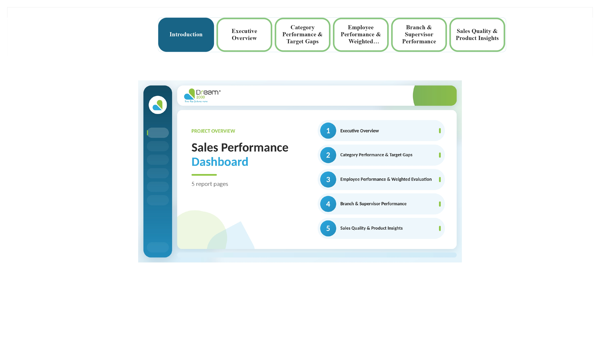
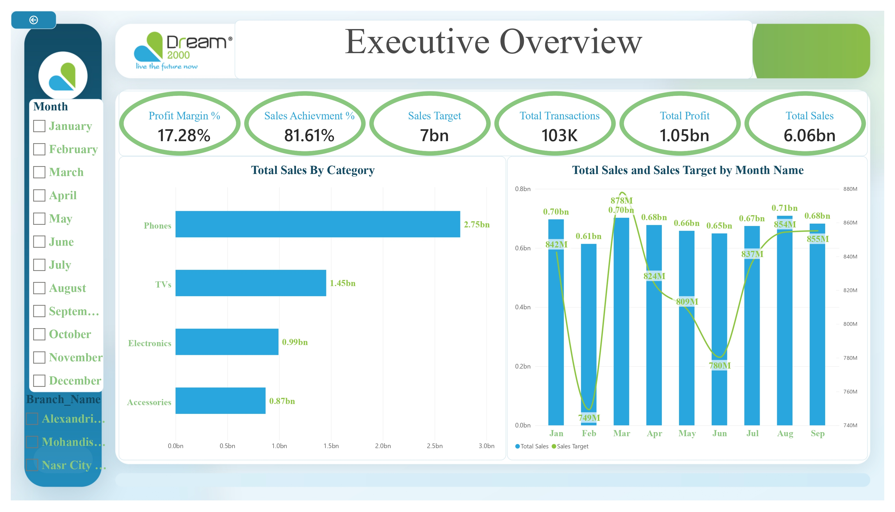
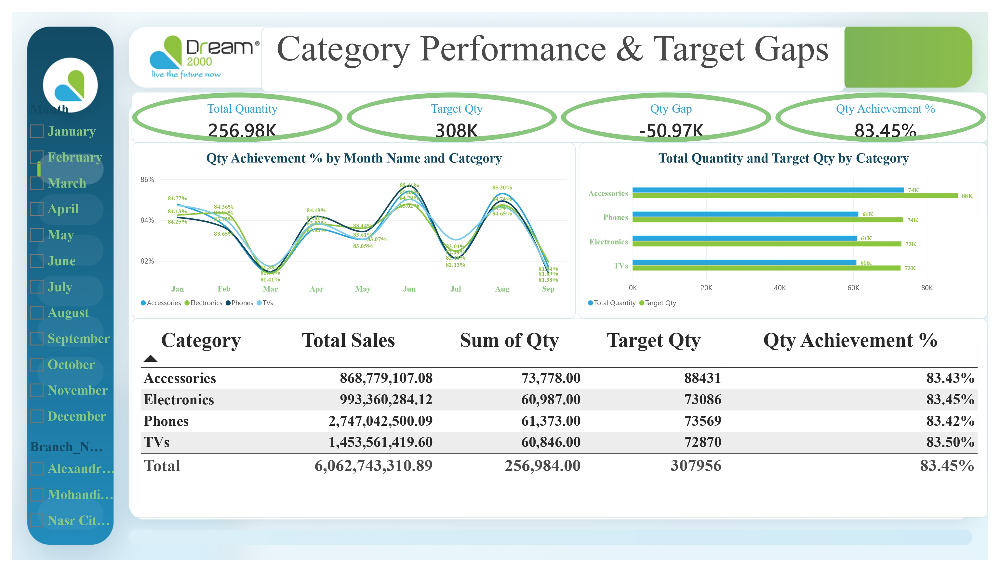
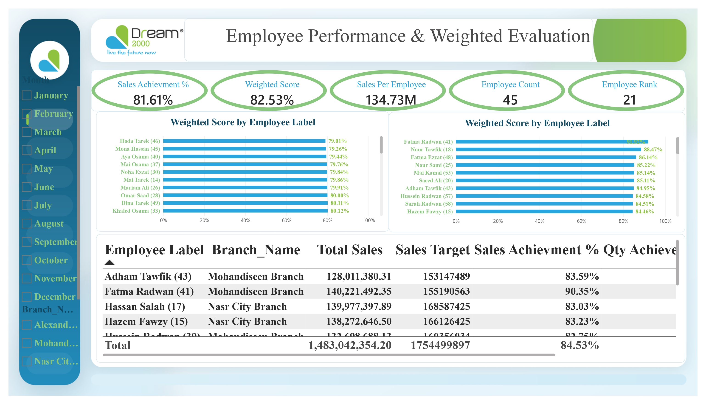
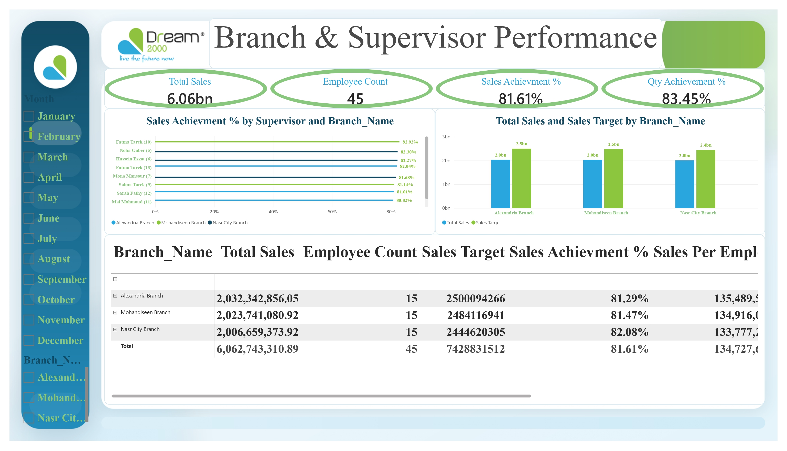
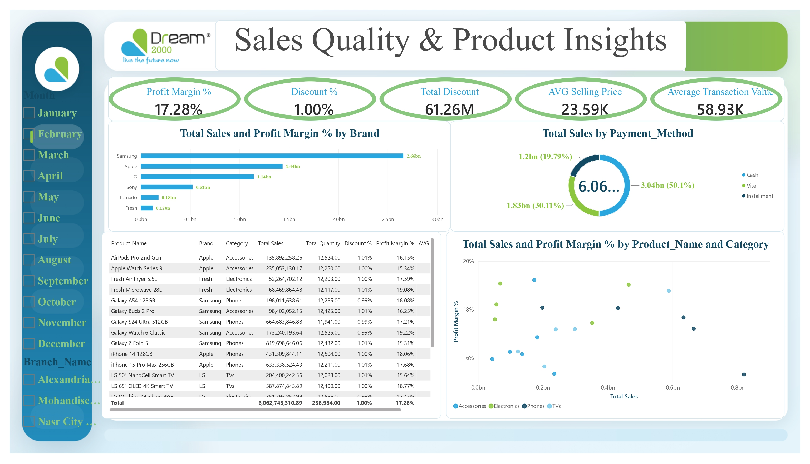

# 📈 Dream 2000 – Sales Performance Dashboard (Power BI)

![Introduction]

A Power BI project that analyzes the sales performance of Dream 2000 across categories, branches, supervisors, employees, brands, and payment methods, and compares actual results against sales and quantity targets.

In this project, I imported the data into Power BI, cleaned and transformed it using Power Query, and built a multi-page interactive report with a custom branded design, navigation buttons, and a project introduction page.

---

## 🎯 Project Objective

To build an interactive report that helps management answer questions such as:

- 💰 How much did we sell compared to the target?
- 📦 Which categories and brands drive the most sales?
- 🎯 Where are the gaps between actual and target quantities?
- 🏢 How do branches and supervisors compare?
- 🧑‍💼 Who are the top and bottom performing employees on a weighted score?
- 💳 How do payment methods, discounts, and profit margins look across products?

---

## 🛠️ Tools Used

- 📊 **Microsoft Power BI Desktop** – data modeling, visualization, navigation, and interactivity
- 🔄 **Power Query** – data import and transformation
- 🧹 **Data Cleaning** – preparing the data for analysis

---

## 🧹 Data Preparation

The data was imported into Power BI and prepared using Power Query.

The preparation included:

- 🔍 Reviewing the dataset structure and column types
- 🧹 Cleaning inconsistent and missing values
- 📅 Preparing date fields for monthly analysis
- 🏷️ Standardizing categories, brands, and branch names

---

## 📊 Report Pages

### 0️⃣ Introduction

A cover page with the project overview and a navigation menu to all report pages.



---

### 1️⃣ Executive Overview

A high-level summary of sales against target.

- 💰 Total Sales, Total Profit, Profit Margin %, Sales Target, Sales Achievement %, Total Transactions
- 📦 Total Sales by Category
- 📈 Total Sales and Sales Target by Month
- 🎛️ Slicers: Month, Branch



---

### 2️⃣ Category Performance & Target Gaps

Compares actual quantities against targets by category.

- 📦 Total Quantity, Target Quantity, Quantity Gap, Quantity Achievement %
- 📊 Total Quantity vs Target Quantity by Category
- 📈 Quantity Achievement % by Month and Category
- 📋 Detailed category table (Total Sales, Quantity, Target, Achievement %)



---

### 3️⃣ Employee Performance & Weighted Evaluation

Evaluates employees using a weighted score.

- 🧑‍💼 Sales Achievement %, Weighted Score, Sales per Employee, Employee Count
- 🏆 Top 10 employees by Weighted Score
- ⚠️ Bottom 10 employees by Weighted Score
- 📋 Employee table (Branch, Total Sales, Sales Target, Achievement %)



---

### 4️⃣ Branch & Supervisor Performance

Compares branches and supervisors against their targets.

- 🏢 Total Sales, Employee Count, Sales Achievement %, Quantity Achievement %
- 📊 Total Sales vs Sales Target by Branch
- 🧑‍💼 Sales Achievement % by Supervisor and Branch
- 📋 Branch table (Sales, Employees, Target, Achievement %, Sales per Employee)



---

### 5️⃣ Sales Quality & Product Insights

Looks at the quality of sales: margins, discounts, brands, and payments.

- 💵 Profit Margin %, Discount %, Total Discount, Average Selling Price, Average Transaction Value
- 🏷️ Total Sales by Brand
- 💳 Total Sales by Payment Method (Cash / Visa / Installment)
- 📋 Product table (Sales, Quantity, Discount %, Profit Margin %)
- 🔵 Total Sales vs Profit Margin % by Product and Category



---

## 🎛️ Interactive Features

- 🎛️ Slicers: Month and Branch on all report pages
- 🔍 Cross-filtering between visuals
- 🧭 Page navigation buttons and a project introduction page
- 🎨 Custom branded design with the Dream 2000 identity

---

## 📌 Key Results

| KPI | Result |
|---|---:|
| 💰 Total Sales | **6.06bn** |
| 💵 Total Profit | **1.05bn** |
| 📊 Profit Margin | **17.28%** |
| 🎯 Sales Target | **≈ 7.43bn** (shown as 7bn on the card) |
| ✅ Sales Achievement | **81.61%** |
| 🧾 Total Transactions | **103K** |
| 📦 Total Quantity / Target | **256.98K / 308K** |
| 📉 Quantity Gap | **-50.97K** |
| ✅ Quantity Achievement | **83.45%** |
| 🧑‍💼 Employees | **45** |
| 🏷️ Discount % / Total Discount | **1.00% / 61.26M** |
| 💳 Average Transaction Value | **58.93K** |

> Figures are as displayed in the report (rounded by Power BI card formatting).

---

## 💡 Key Insights

- 📦 **Phones** led sales with **2.75bn** (about 45% of total sales), followed by TVs (1.45bn), Electronics (0.99bn), and Accessories (0.87bn).
- 🏷️ **Samsung** led brands with **2.66bn**, followed by Apple (1.44bn) and LG (1.14bn).
- 🎯 Sales reached **81.61%** of target, and quantities reached **83.45%**, so both stayed below target.
- 🏢 All three branches had similar sales (about 2.0bn each). **Nasr City** had the highest achievement (**82.08%**), then Mohandiseen (81.47%) and Alexandria (81.29%).
- 🧑‍💼 The highest weighted score was **91.92%** (Fatma Radwan, label 41), and the lowest in the bottom-10 list started at **79.01%**.
- 💳 **Cash** represented **50.1%** of sales, **Visa** 30.11%, and **Installment** 19.79%.
- 📅 Monthly sales stayed between **0.61bn and 0.71bn**, with the lowest month in **February** (0.61bn).

---

## 🔄 Workflow

```text
Raw Data
   ↓
📥 Import Data (Power BI)
   ↓
🧹 Power Query – Cleaning & Transformation
   ↓
🗂️ Data Model
   ↓
📊 Visuals & KPIs
   ↓
🎛️ Interactive Multi-Page Report
   ↓
💡 Business Insights
```

---

## 👩‍💻 Author

**Eman Sayed Seddik**
🔗 [LinkedIn](https://www.linkedin.com/in/eman-sayed-seddik-59bb1616a/)
